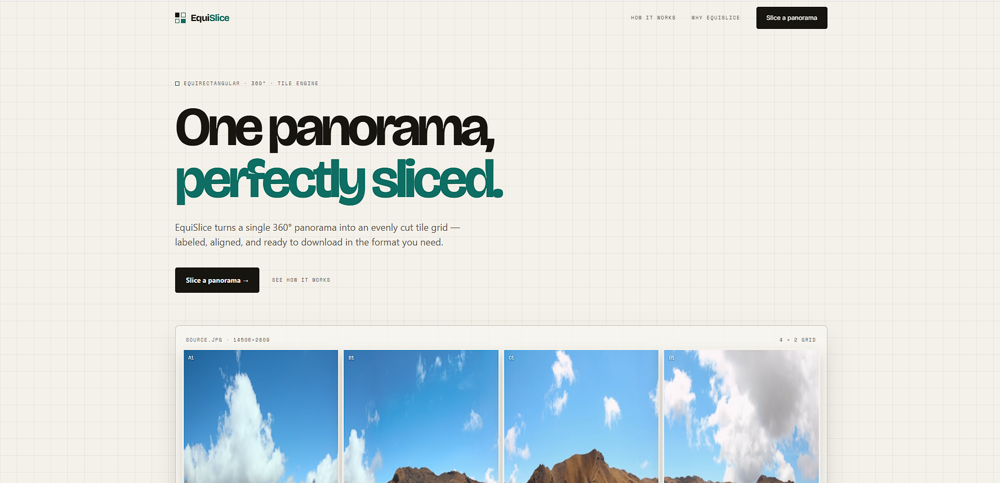
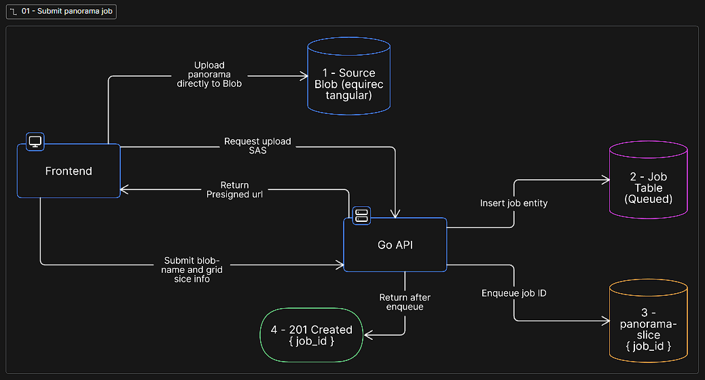
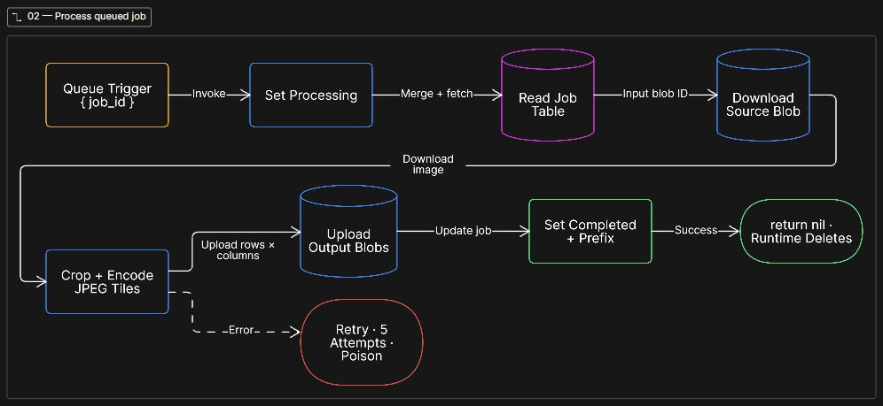
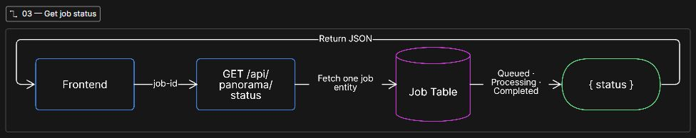
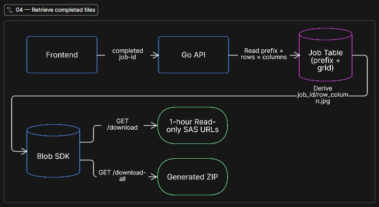
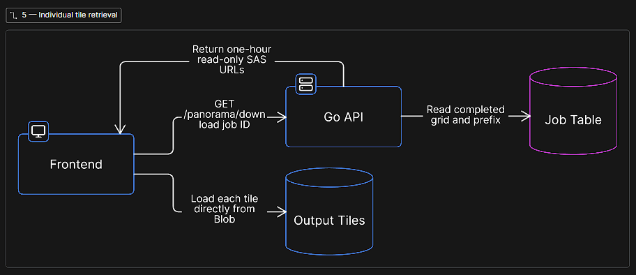
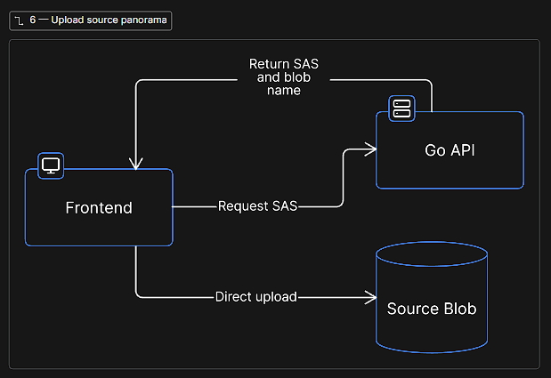

# EquiSlice

EquiSlice turns an equirectangular panorama into an evenly sized grid of JPEG tiles. The browser asks the Go API for a short-lived, write-only Azure Blob SAS URL, uploads the image directly to Blob Storage, then submits the uploaded blob name as a slicing job. The API records and queues that job, and an Azure Queue-triggered Function generates the tiles.



## Project layout

| Directory | Purpose |
| --- | --- |
| `frontend/` | React + Vite cutter experience |
| `backend/` | Go HTTP API and Azure Blob, Queue, and Table Storage integration |
| `azure-functions/` | Go Azure Function that consumes panorama slice jobs |
| `terraform/` | Azure infrastructure configuration |

The cutter frontend lives in `frontend/src/features/cutter/`. Its page composes
display components and a React Hook Form form; `forms/cutterForm.schema.ts` owns
Zod validation and defaults. The `hooks/` folder handles image preview lifecycle,
job submission and polling, and tile downloads. HTTP requests stay in `api/`, with
shared feature types in `types/`. Keep new cutter logic in these modules so the
page stays focused on composing the screen.

## Architecture flows

### 1. Submit a panorama job



The upload is deliberately split into two API calls: `POST /api/panorama/upload` returns a blob-specific upload SAS URL and blob name; the browser uploads the image directly to that URL; then `POST /api/panorama/slice` creates the job from the blob name and grid settings. The Go API never proxies the panorama bytes.

### 2. Process the queued job



### 3. Check job status



### 4. Retrieve completed tiles



### 5. Individual tile retrieval



### 6. Upload source panorama



The frontend calls the local backend directly at `http://localhost:3000/api`; there is no development proxy.

## Prerequisites

- Node.js 20+
- Go 1.26.3+
- An Azure Storage account connection string, or Azurite for local Function development
- Azure Functions Core Tools if running the Function locally

## Local setup

### 1. Configure the backend

Create `backend/.env` with your Azure Storage connection string and local frontend origin:

```dotenv
AZURE_CONNECTION_STRING=<Azure Storage connection string>
FRONTEND_URL=http://localhost:5173
```

Never commit this file or a real connection string.

### 2. Start the backend

```powershell
Set-Location backend
go run ./cmd
```

The API listens on `http://localhost:3000`.

### 3. Start the frontend

In another terminal:

```powershell
Set-Location frontend
npm install
npm run dev
```

Open `http://localhost:5173/cutter`.

The cutter saves the most recent panorama job UUID in browser `localStorage`. Reloading or restarting the browser resumes status polling for that job. A newly created job replaces the stored UUID.

## API

| Method | Endpoint | Description |
| --- | --- | --- |
| `GET` | `/api/health` | Health check |
| `POST` | `/api/panorama/upload` | Returns a short-lived, write-only Blob SAS URL and generated source blob name for a JPG or PNG upload |
| `POST` | `/api/panorama/slice` | Creates a panorama slicing job from JSON: `file` (the uploaded blob name), `rows`, `columns`, and `file_formats` |
| `GET` | `/api/panorama/status?job-id=<uuid>` | Returns the job status |
| `GET` | `/api/panorama/download?job-id=<uuid>` | Returns download URLs when processing is complete |
| `GET` | `/api/panorama/download-all?job-id=<uuid>` | Downloads all completed tiles as one ZIP archive |

## Azure Function

The Function in `azure-functions/` listens to the `panorama-slice` queue and uses:

- `AzureWebJobsStorage` for the queue-trigger binding
- `EQUISLICE_STORAGE_CONNECTION_STRING` for Blob and Table Storage access

For a cloud-backed local test, configure both variables with the same Azure Storage connection string. For an entirely local Function setup, start Azurite and use the local values in `azure-functions/local.settings.json`.

```powershell
Set-Location azure-functions
func start
```

The Go Function worker uses `FUNCTIONS_WORKER_RUNTIME=native` locally. The deployed Flex Consumption app uses its runtime configuration (`go`, version `1.0`) rather than that local setting.

## Observability

| Tool | Covers | Configured by |
| --- | --- | --- |
| Sentry | Errors from the frontend (`VITE_SENTRY_DSN`), API, and Function (`SENTRY_DSN`, `SENTRY_ENVIRONMENT`) | `.env` files locally, app settings in Azure |
| OpenTelemetry → Grafana Cloud | Traces from the API and Function; HTTP metrics from the API | `OTEL_*` variables |
| Application Insights | Function host logs and invocations | Terraform |

### Traces

A slicing job appears in Grafana Cloud (Explore → Tempo) as one trace across both
services:

1. `POST /api/panorama/slice` — the API request span (service `equislice-api`).
2. `panorama-slice send` — the API enqueues the job and writes the W3C trace
   context into the queue message.
3. `panorama-slice process` — the Function continues the same trace from that
   message (service `equislice-function`), with child spans for Blob and Table
   Storage calls.

Search by `service.name` = `equislice-api` or `equislice-function`. API metrics
come from the `otelhttp` middleware (for example, request duration by route).

### Configuration

Both services use the standard OpenTelemetry environment variables and the OTLP
HTTP exporter, so no code changes are needed to point them elsewhere:

```dotenv
OTEL_SERVICE_NAME=equislice-api
OTEL_EXPORTER_OTLP_ENDPOINT=https://otlp-gateway-prod-<region>.grafana.net/otlp
OTEL_EXPORTER_OTLP_HEADERS="Authorization=Basic <base64 of instanceId:token>"
OTEL_RESOURCE_ATTRIBUTES=deployment.environment=local
```

Grafana Cloud generates these values under your stack's OpenTelemetry
configuration page. Locally, add them to `backend/.env` (use
`OTEL_SERVICE_NAME=equislice-function` in the `Values` of
`azure-functions/local.settings.json`). If they are missing, the exporter falls
back to `localhost:4318` and logs export errors, but the services keep running.

In Azure, Terraform sets these variables on both apps. The auth header (and the
Sentry DSNs) are Key Vault references resolved at runtime; see
[`terraform/README.md`](terraform/README.md#key-vault-secrets) to rotate them.

## Validation commands

Install frontend dependencies to enable Husky's local pre-commit hook:

```powershell
npm ci --prefix frontend
```

Before each commit, the hook runs Go linting, tests, and Linux builds for both
services, followed by frontend linting, tests, and the production build. Node.js
and Go must be available to Git. Build executables go into ignored `bin/` folders.
Checks validate the working tree, so stage the code you validated before committing.
GitHub Actions keeps its own existing validation commands.

```powershell
Set-Location frontend
npm test
npm run build
npm run lint
```

## Security note

Storage account keys and connection strings grant broad storage access. Keep them in local environment files or Azure app settings, not in source control. If a key is ever exposed, rotate it and update the backend and Function App configuration together.

In Azure, third-party secrets (Sentry DSNs and the Grafana OTLP token) live only in the `equislice-kv-renn244` Key Vault. To rotate one, update the secret in the vault and restart the affected app; no Terraform run is needed.
